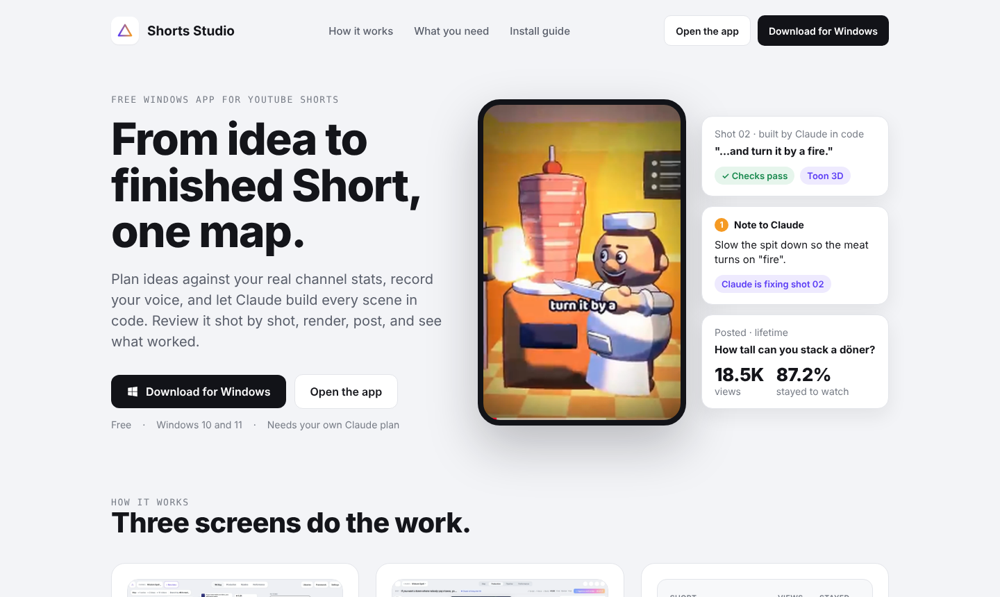

# Shorts Studio site

**The public website for Shorts Studio: a landing page, an install guide, and a page that opens the app on your PC.**

[](https://seifpetit.github.io/shorts-studio-site/) 

Shorts Studio is a free Windows app for making YouTube Shorts with Claude: plan ideas against real channel stats, let Claude build toon 3D scenes in code, review shot by shot, then render and post. This repo is only its public front door. It's a plain static site with no build step, and it hands people the Windows installer and opens the installed app.



## Pages

| Page | What it does |
| --- | --- |
| [`index.html`](index.html) | Landing page. Every Download button goes to the install guide, which starts the download. |
| [`install.html`](install.html) | Four install steps: download, the Windows warning, fast or custom install, connecting Claude Code. `install.html?dl=1` starts the download on arrival. |
| [`connect.html`](connect.html) | Opens the installed app through its `shortsstudio://` link. Shows "Nothing happened? Download it" after 3 seconds. |

## How "Open the app" works

The app's installer registers the `shortsstudio://` link type with Windows. The connect page sends the browser to `shortsstudio://open`, the browser asks once for permission, and Windows starts the app, which opens `localhost:4870` in a new tab. The page never talks to the app in the background.

- `connect.html?auto=1` tries to open the app as soon as the page loads.
- `connect.html?to=/series/brakes` opens a specific screen (`shortsstudio://open/series/brakes`).

## Run it locally

No install or build needed. Serve the folder and open it:

```sh
git clone https://github.com/Seifpetit/shorts-studio-site.git
cd shorts-studio-site
python -m http.server 8000
```

Then open <http://localhost:8000>.

## Change the links in one place

The installer address and the app's link type are both in [`assets/site.js`](assets/site.js), in the `SITE` object at the top.

## Where the installer goes

The `.exe` is not stored in this repo. It's attached to this repo's GitHub Releases, and the site always links to the newest one. See [Releases](docs/releases.md) for the steps.

## Known issues

- No installer has been released yet, so the download buttons lead to a GitHub 404 for now.
- The döner frame in the hero is an upscaled phone screenshot and looks soft. Replace `assets/img/doner.webp` with a full-size frame from the render.
- The Analyze card shows a hand-built table, not a screenshot of the app's Performance page.
- The Windows warning and installer pictures on the install guide are illustrations, not real screenshots.
